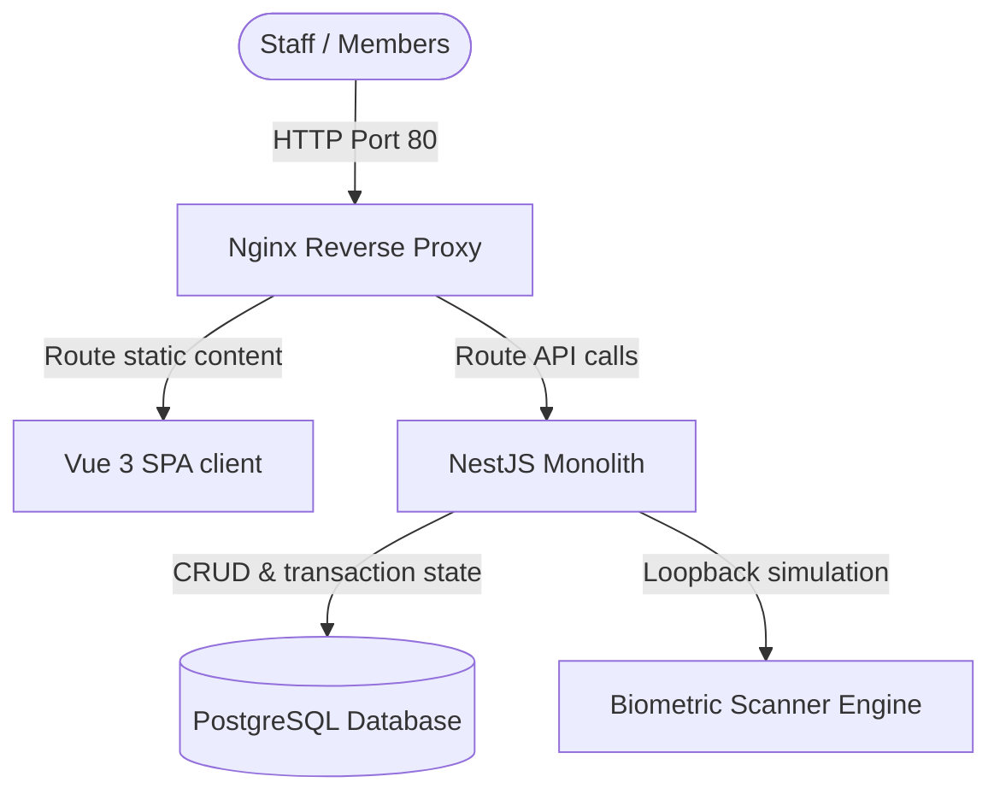

# System Architecture - Gym Access Control System (v1)

This document describes the offline-first monolithic design of the Gym Access Control System.

## 1. Monolithic Topology

The system is hosted on-premise at the gym's reception desk. It operates completely disconnected from the internet. All system components are bundled inside docker containers.

---

## 2. Backend Modules & Domain Modeling

The backend is written in NestJS, utilizing TypeScript. It is split into distinct modules:
- **Auth Module**: JWT generation, authentication, and RBAC token injection.
- **Members Module**: Member card profiles, physical description notes, and emergency contact registries.
- **Memberships Module**: Configures plans (Daily, Weekly, Monthly, etc.) and records active plans.
- **Payments Module**: Records payments (Cash, Credit, Debit, Transfer) and handles cancellations/refunds.
- **Biometrics Module**: Simulates pattern matches and writes to security logs.
- **Analytics Module**: Aggregates statistics for charts and widgets.

---

## 3. Frontend Stores & State Machine

The client application is built with Vue 3, Pinia, and TailwindCSS. State is managed via Pinia:
1. `auth.store.ts`: Tracks login token, user payload, and role permissions.
2. `member.store.ts`: Holds search queries, member details, active plans, and payments lists.
3. `biometric.store.ts`: Coordinates the simulated fingerprint scan stages:
   `waiting` ➔ `scanning` ➔ `matched` ➔ `result (Success / Denied)`

---

## 4. Database Schema Structure

The PostgreSQL schema is structured for auditing and integrity, including primary keys as UUIDs, created/updated timestamps, and soft-delete properties (`deleted_at`).
Performance indexes are placed on search fields (`member_number`, `email`) and access streams (`member_id`, `scanned_at`).
